# Égide

Simulation de défense du territoire face à un essaim de drones rapides. Le défenseur dispose de trois couches :
des radars qui couvrent le territoire, des postes sol-air sur les cibles, et des avions turbopropulseurs en
orbite armés de roquettes guidées laser ou IR.

Égide répond à deux questions, avec un fond mathématique explicite et des résultats reproductibles :

- **À quelle vitesse les avions doivent-ils se mettre à poste**, selon leur nombre, pour intercepter un essaim
  dont on ne connaît pas la route ?
- **Combien de postes sol-air faudrait-il sans avions**, et combien la couche aérienne en épargne ?

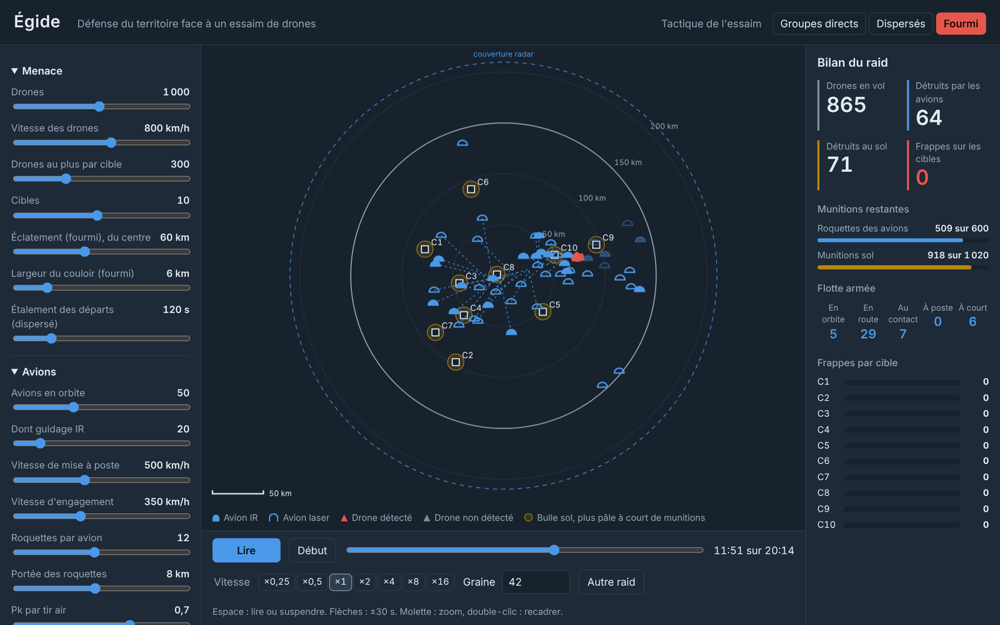

> Scénario notionnel : ordres de grandeur publics, aucune performance réelle de système identifié.
> Chaque valeur chiffrée vient de [scenarios/reference.json](scenarios/reference.json), qui dit pour chaque clé à quoi elle sert.

## En bref

Avec le scénario de référence (1 000 drones à 800 km/h, 10 cibles, 200 postes sol, 50 avions à 500 km/h),
moyenne sur 30 raids et intervalle de confiance à 95 % :

| Tactique de l'essaim | Frappes sans avions | Frappes avec 50 avions | Détruits par les avions |
|---|---|---|---|
| Groupes directs | 650 ± 21 | 395 ± 27 | 257 |
| Dispersés | 524 ± 8 | **187 ± 11** | 407 |
| Fourmi (couloir compact puis éclatement) | 668 ± 19 | 401 ± 25 | 272 |

- Les avions divisent les frappes par 1,6 à 2,8. La tactique fourmi est la plus efficace pour l'attaquant :
  le couloir compact sature chaque avion sur un passage, et l'éclatement tardif oblige la flotte à se partager.
- Face aux groupes compacts, les avions ne tirent que 60 % de leurs roquettes : la limite est la cadence par
  passage, pas le stock. Au sol de même, environ la moitié des munitions reste inutilisée.
- Avec 50 avions, garantir 5 avions sur une route quelconque demande ~350 km/h ; 8 avions, ~465 km/h ;
  10 avions, ~525 km/h. Avec 20 avions, 5 garantis demandent déjà ~600 km/h.

## Lancer

macOS : double-clic sur `lancer.command`. Windows : `lancer.bat`. La page s'ouvre sur http://127.0.0.1:8766.

Rien à installer pour l'interface : JavaScript sans compilation, servi par le serveur HTTP de Python.

## L'interface

### Le scope

L'écran reprend les codes d'une situation aérienne : anneaux de distance tous les 50 km, limite de la zone,
couverture radar basse altitude en pointillés, balayage du faisceau. Les drones apparaissent en plots
rafraîchis toutes les 4 s, avec leur historique. La symbologie s'inspire d'APP-6 :

| Symbole | Signification |
|---|---|
| Dôme bleu plein | Avion armé de roquettes IR |
| Dôme bleu creux | Avion armé de roquettes laser |
| Demi-losange rouge | Drone détecté (gris tant qu'il ne l'est pas) |
| Carré blanc | Cible ; rouge au moment d'une frappe |
| Cercle ocre | Bulle d'un groupe de postes sol, plus pâle à mesure qu'il épuise ses munitions |
| Pointillés bleus | Route d'un avion vers son point de mise à poste |

La molette zoome, le glisser déplace la vue, le double-clic recadre. Le survol décrit chaque entité :

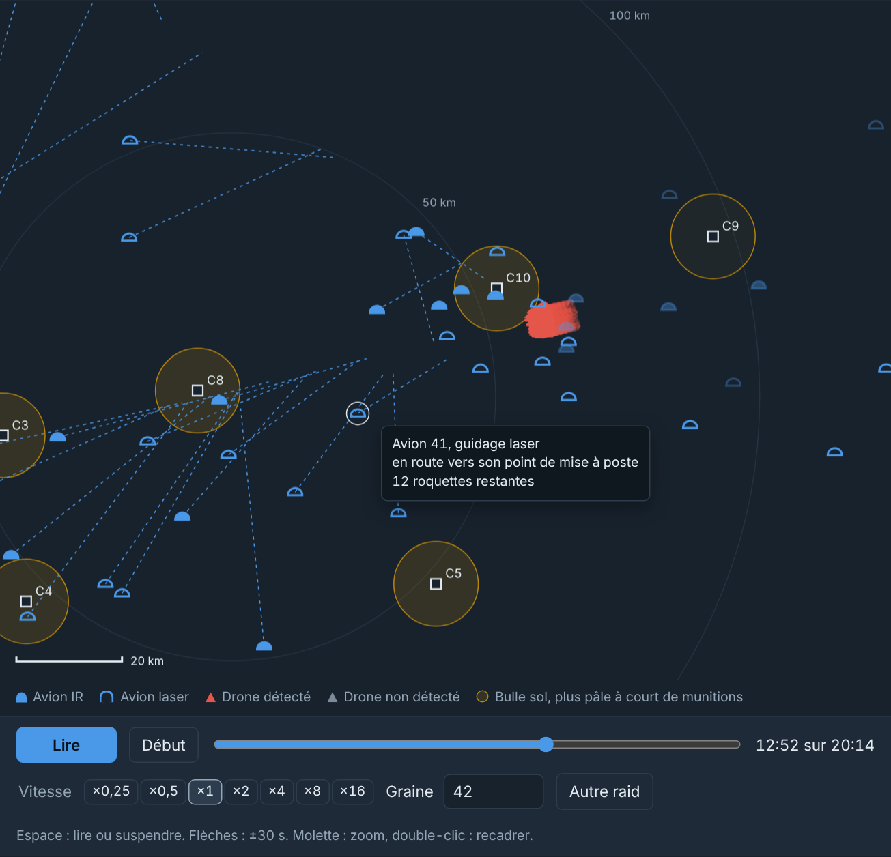

### Trois tactiques adverses

<table>
<tr>
<td width="50%">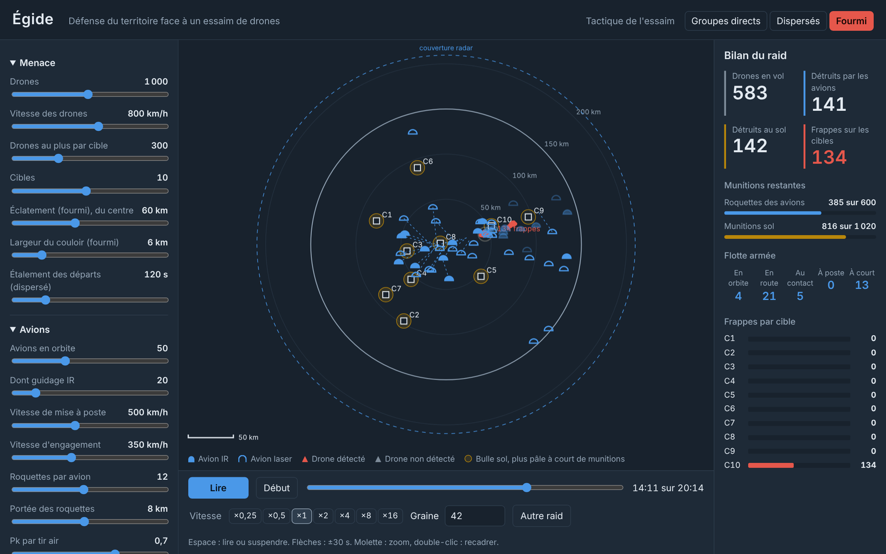</td>
<td width="50%">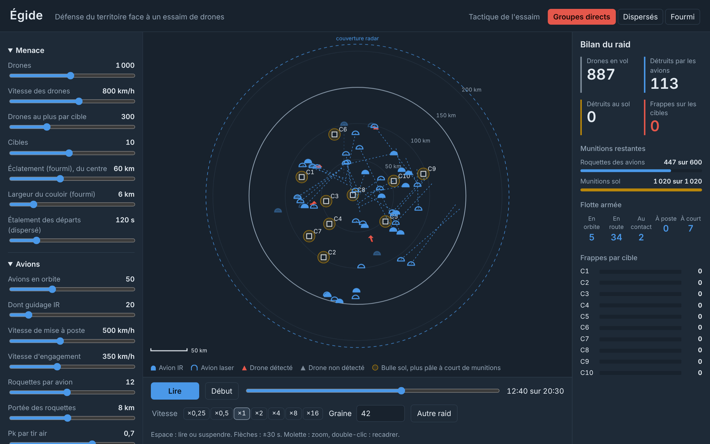</td>
</tr>
<tr>
<td><b>Fourmi</b> : tout l'essaim entre par un même couloir, puis éclate vers ses cibles. Ici, juste après l'éclatement près de C10.</td>
<td><b>Groupes directs</b> : chaque groupe arrive d'un cap tiré au hasard, en vague serrée, droit sur sa cible.</td>
</tr>
<tr>
<td colspan="2"></td>
</tr>
<tr>
<td colspan="2"><b>Dispersés</b> : chaque drone vient seul, de n'importe quel cap, avec des départs étalés. C'est la tactique la plus facile à défendre : les avions trouvent des cibles partout et vident presque tout leur emport.</td>
</tr>
</table>

### Avec ou sans couche aérienne

Même raid fourmi, même graine, en fin de raid :

<table>
<tr>
<td width="50%">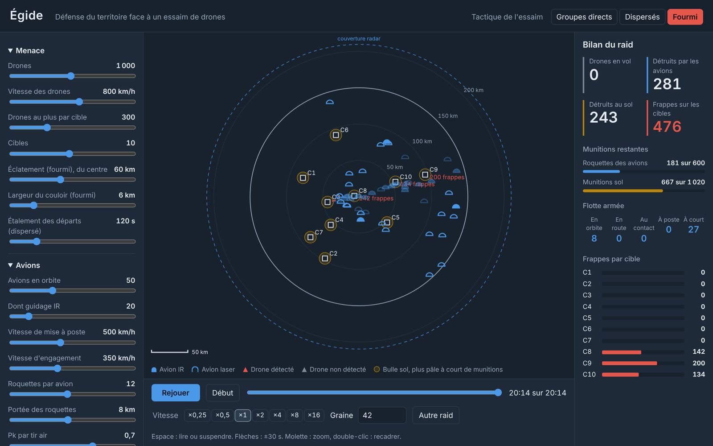</td>
<td width="50%">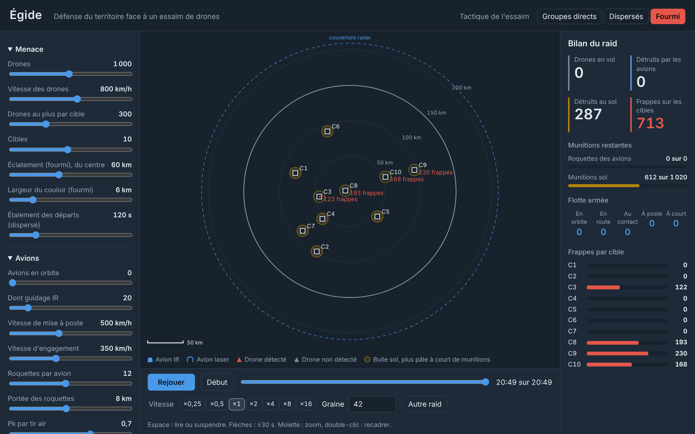</td>
</tr>
<tr>
<td>Avec 50 avions : <b>476 frappes</b>.</td>
<td>Sans avions : <b>713 frappes</b>.</td>
</tr>
</table>

### Réglages, lecture et rejeu

- Un curseur par clé du scénario, groupés par couche (menace, avions, sol, détection et conduite). L'info-survol
  de chaque curseur reprend la phrase d'aide du fichier de scénario. Chaque geste relance le raid.
- Lecture de ×0,25 à ×16 (×1 = 20 s simulées par seconde). Espace pour lire ou suspendre, flèches pour ±30 s.
- La frise permet d'aller à n'importe quel instant, en avant comme en arrière : le raid est rejoué depuis la
  graine, donc à l'identique. « Autre raid » change la graine.
- Les réglages s'enregistrent dans le navigateur ; « Exporter le scénario » télécharge le JSON complet,
  réutilisable par les campagnes en ligne de commande.

### Balayage

Le panneau de balayage fait varier un réglage, rejoue le raid sur plusieurs graines pour chaque valeur, et
trace chaque grandeur avec son intervalle de confiance. Le calcul tourne en arrière-plan : l'animation reste fluide.

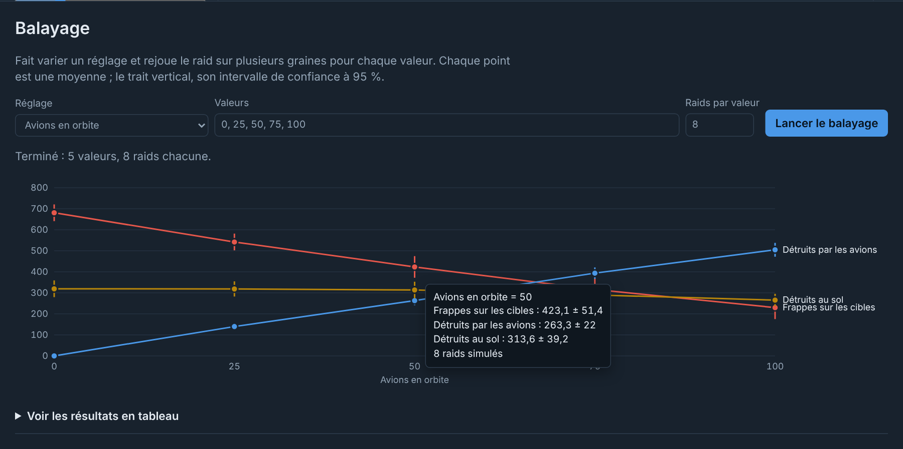

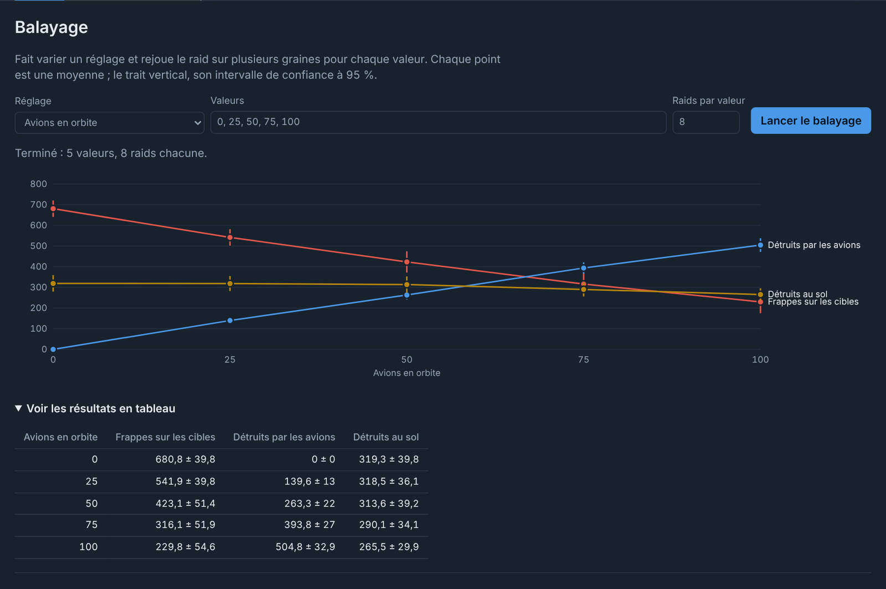

### Sur téléphone

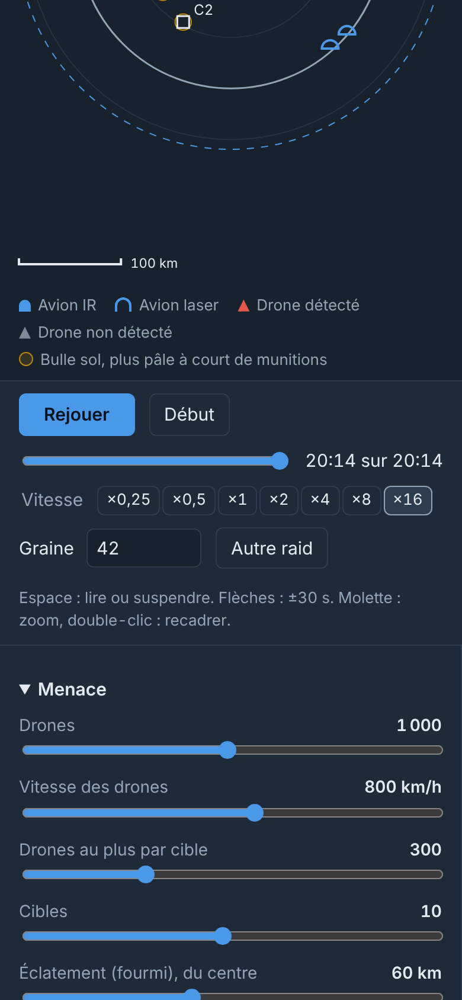

## Les trois étapes

### 1. Abaques analytiques (`analyse/`, Python)

Les formules fermées de [docs/MODELE.md](docs/MODELE.md) : horizon radar, délai de mise à poste, nombre
d'avions concentrables, vitesse minimale, postes sol nécessaires, pré-attrition par la couche aérienne.

```sh
uv run --with matplotlib python -m analyse.abaques                 # figures et recapitulatif.md dans resultats/abaques/
uv run --with matplotlib python -m analyse.abaques --concentration 400
```

<table>
<tr>
<td width="50%">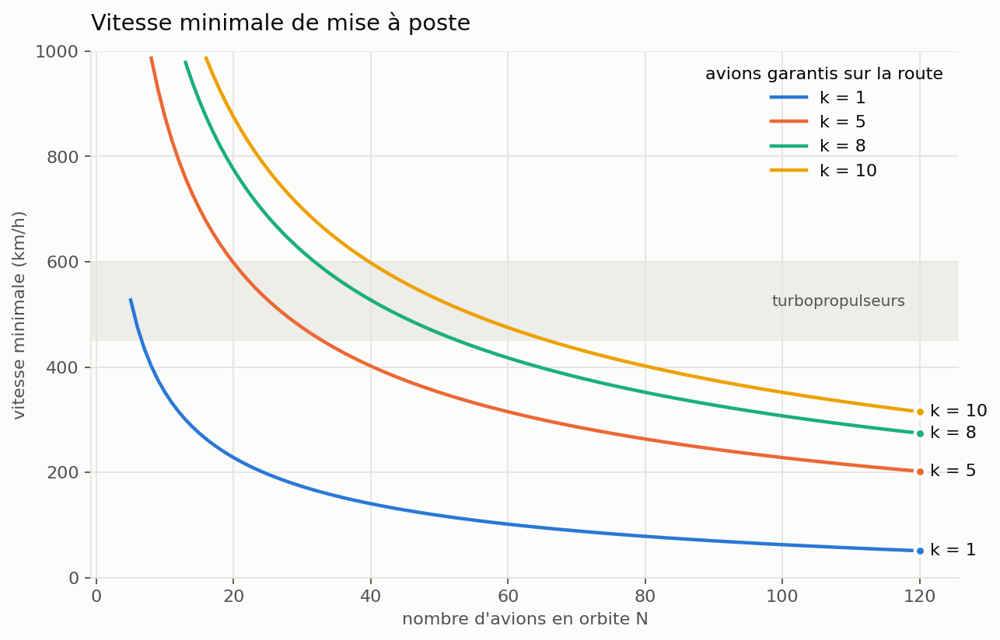</td>
<td width="50%">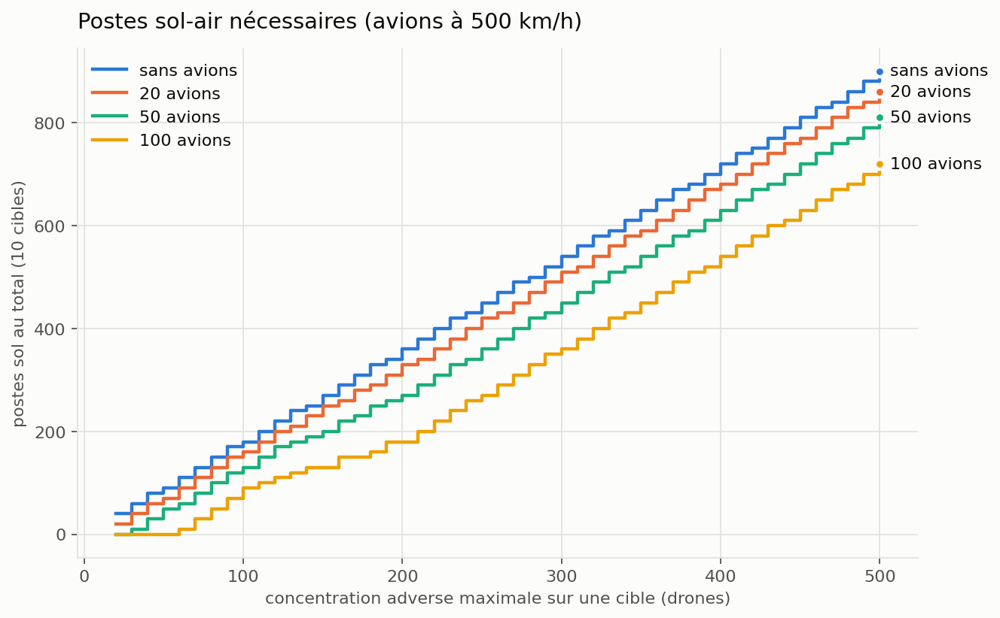</td>
</tr>
<tr>
<td>Vitesse minimale de mise à poste pour garantir k avions sur une route quelconque. La bande grise est la plage des turbopropulseurs.</td>
<td>Postes sol nécessaires selon la concentration adverse par cible, sans avions puis avec 20, 50 et 100 avions.</td>
</tr>
</table>

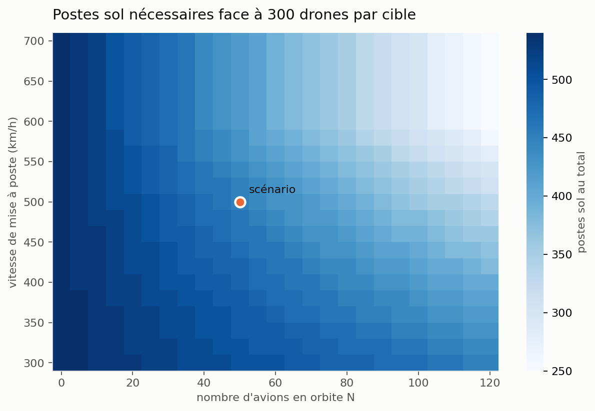

### 2. Simulation multi-agents (`src/moteur/`, JavaScript pur)

Le moteur ne touche ni au DOM ni au réseau : il tourne dans le navigateur comme sous Node. Toute la simulation
tire son hasard d'un générateur à graine ; un raid de 1 000 drones se calcule en moins d'une seconde.

```sh
node src/campagne.js                                          # scénario de référence, 50 raids
node src/campagne.js --tirages 200 --drones_tactique direct   # toute clé du scénario se règle ainsi
node src/campagne.js --balayer avions_nombre=0,20,50,100      # une campagne par valeur
```

Chaque grandeur est rendue en moyenne ± intervalle de confiance à 95 %, et enregistrée en JSON dans
`resultats/campagnes/`. Les hypothèses de la simulation (détection, extrapolation des pistes, planification,
tirs) sont au § 8 du modèle.

### 3. Interface graphique (`index.html`, `src/vue/`)

Décrite plus haut. La vue ne contient aucun calcul de défense : elle anime le moteur et lit son journal
d'évènements.

## Rigueur

- Unités SI dans tout le calcul ; conversions seulement à la lecture du scénario et à l'affichage.
- Chaque formule codée cite son paragraphe de [docs/MODELE.md](docs/MODELE.md).
- Les formules fermées existent en Python et en JavaScript ; [tests/references.json](tests/references.json)
  vérifie que les deux rendent les mêmes valeurs.
- La simulation est confrontée aux formules : la défense sol seule retrouve le § 5 du modèle (tirs par poste,
  destructions = tirs × Pk à l'intervalle de confiance près).
- Limites connues : drones sans contre-mesures ni évitement, radar parfait dans sa couverture, pas de
  rechargement des avions pendant le raid (MODELE § 7).

## Organisation du dépôt

```
analyse/            étape 1 : formules fermées, dimensionnement, abaques (Python)
src/moteur/         étape 2 : simulation pure (JS) — hasard, scénario, menace, défense air et sol, monde
src/vue/            étape 3 : scope, réglages, lecture, tableau de bord, balayage
src/campagne.js     campagnes Monte-Carlo en ligne de commande
scenarios/          scénarios JSON, chaque clé documentée dans son bloc _aide
docs/MODELE.md      toutes les équations et hypothèses
docs/PLAN.md        plan des trois étapes
tests/              tests JS (node --test) et Python (pytest)
```

## Tests

```sh
npm test                    # moteur, vue, références croisées
pytest -q tests             # formules, scénario, dimensionnement, abaques
ruff check analyse tests
```
