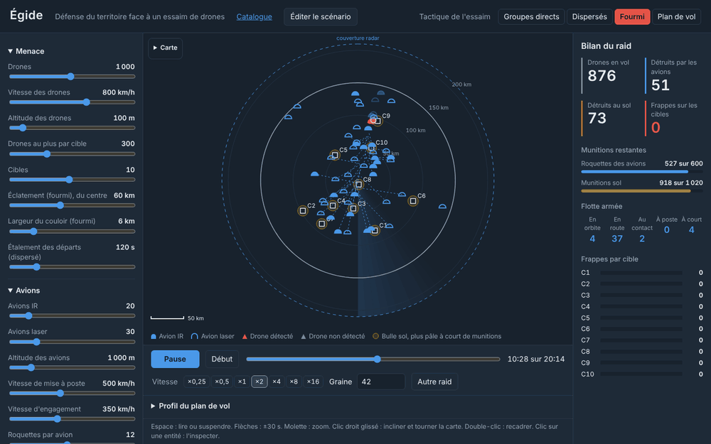
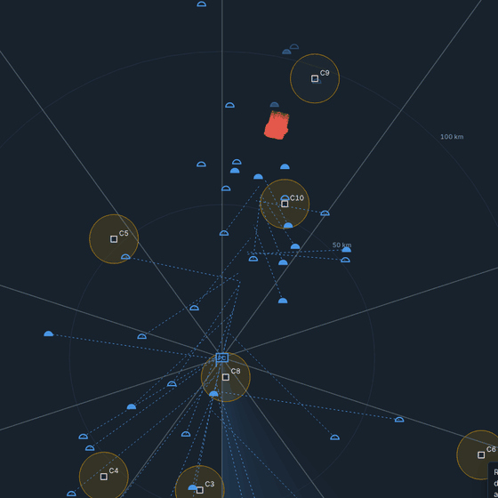
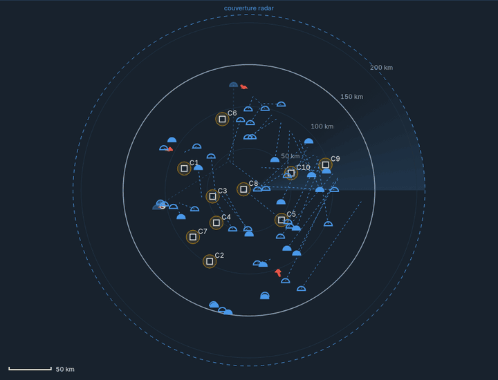
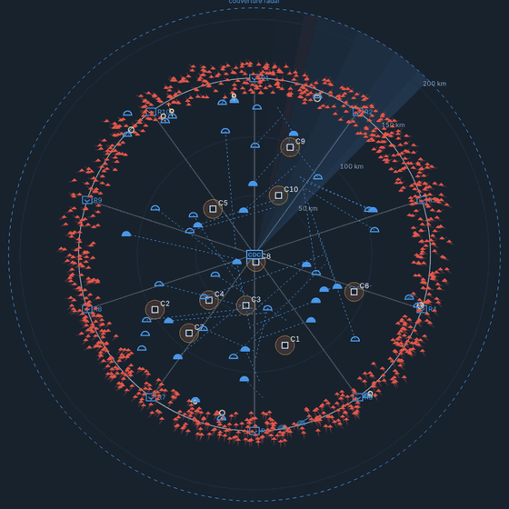
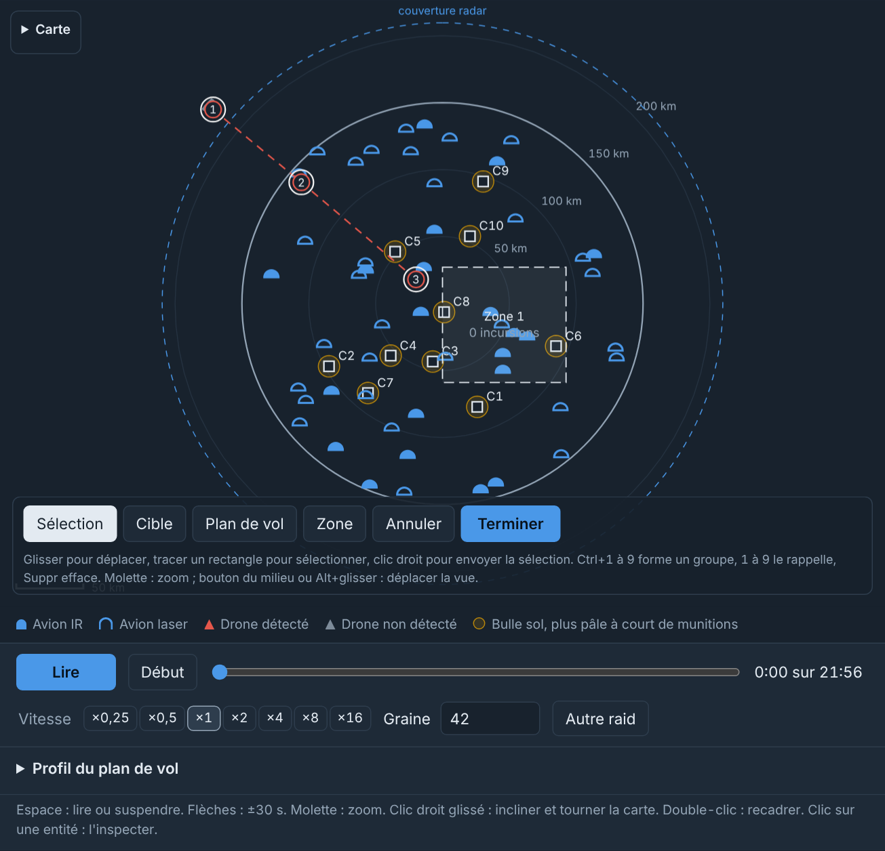
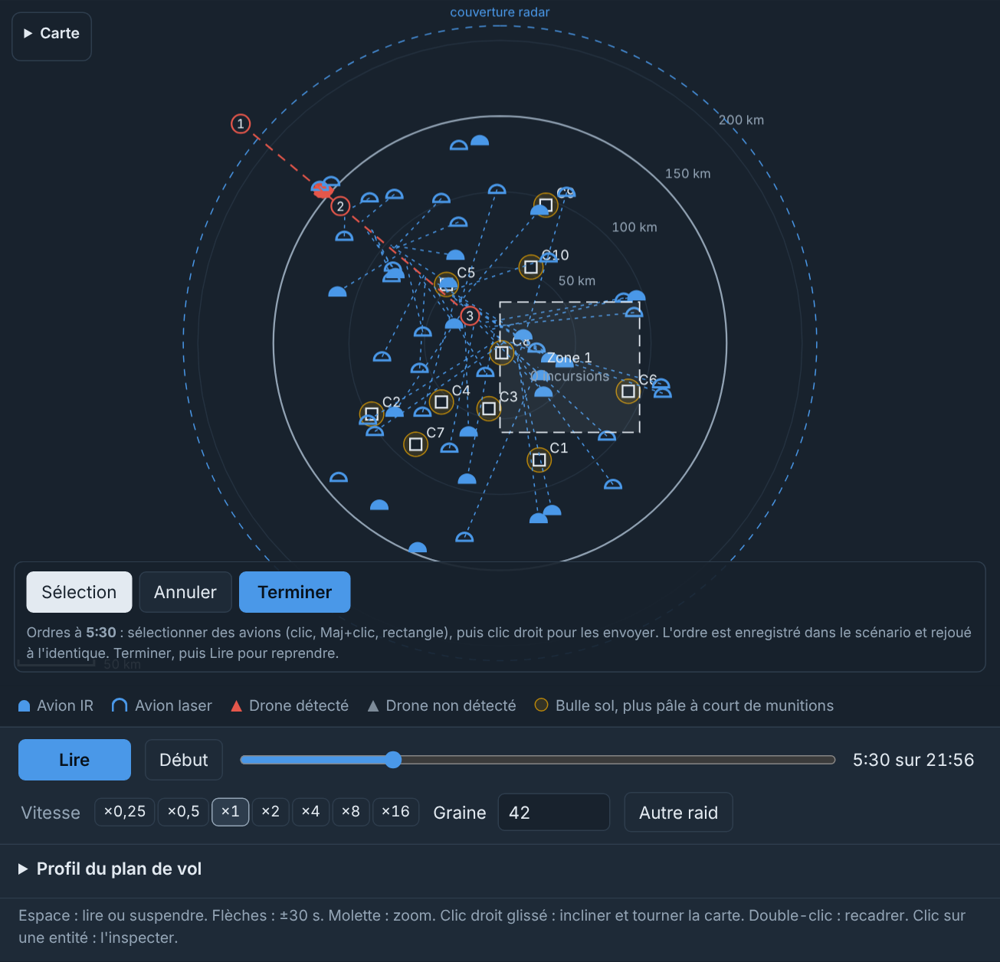
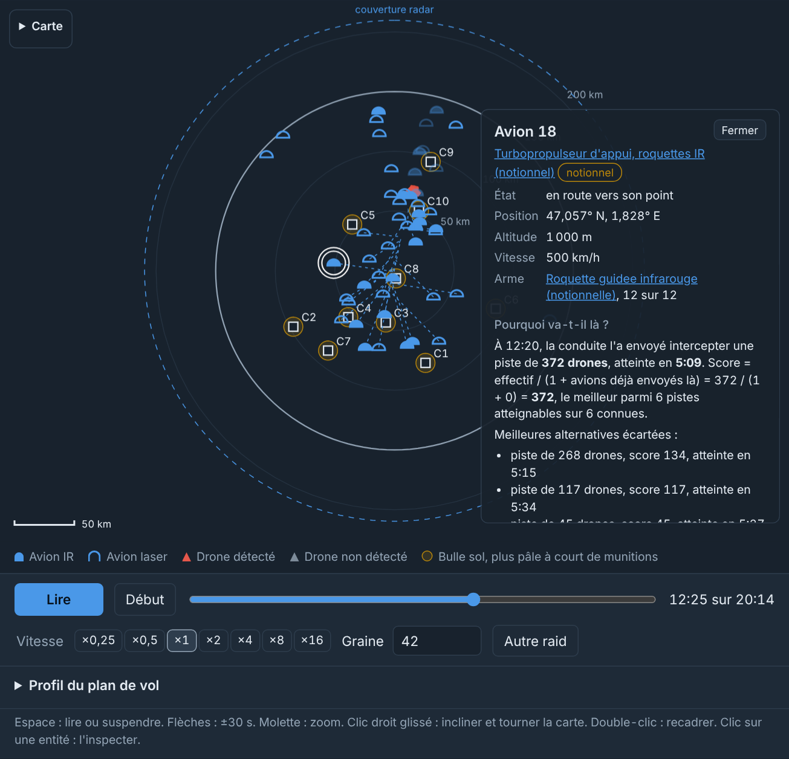
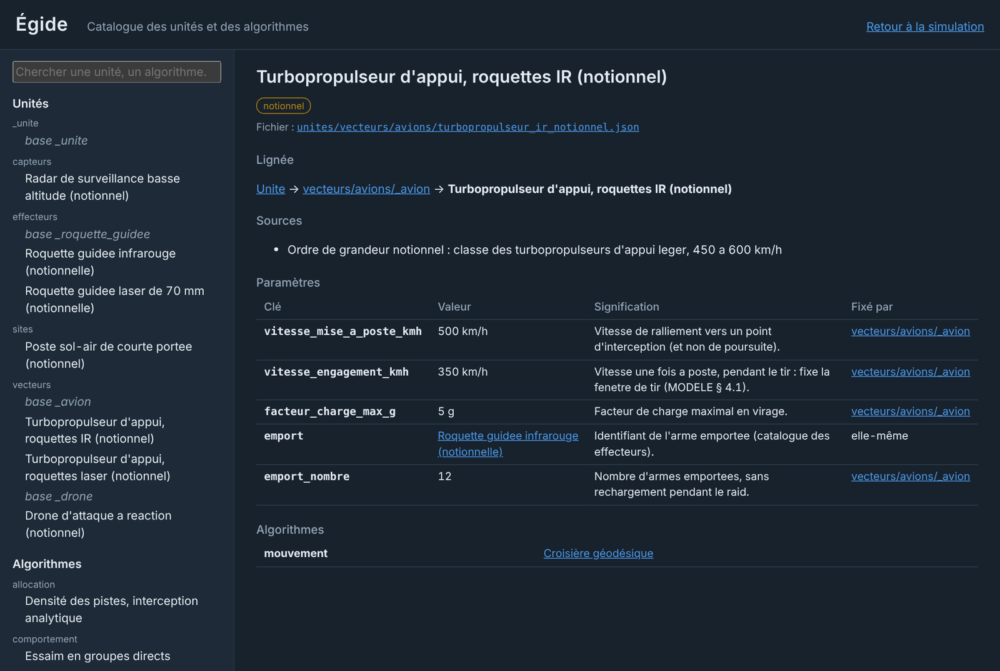
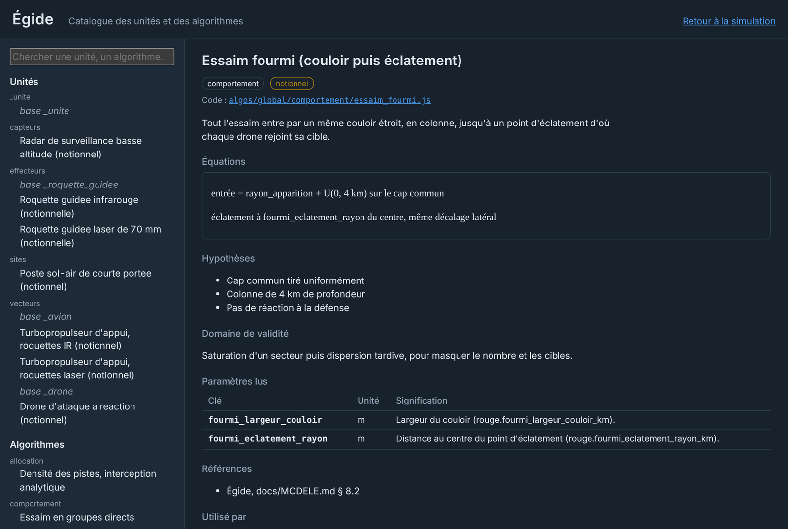

# Égide

Simulation de défense du territoire face à un essaim de drones rapides, jouable comme un jeu de stratégie vu de
dessus et assez rigoureuse pour en prouver les résultats. Le défenseur dispose de radars, de postes sol-air sur les
cibles et d'avions en orbite armés de roquettes guidées ; l'attaquant choisit sa tactique, ou suit le plan de vol que
vous dessinez.



> Scénario notionnel : ordres de grandeur publics, aucune performance réelle de système identifié. Le dépôt public
> ne contient que des modèles notionnels ; les modèles de systèmes réels se rangent dans un catalogue privé
> (`prive/`, ignoré par git) que l'outil charge de la même façon.

## Ce que fait Égide

- **Répond à deux questions** : à quelle vitesse les avions doivent-ils se mettre à poste, selon leur nombre, pour
  intercepter un essaim dont on ignore la route ? Combien de postes sol-air faudrait-il sans eux ?
- **Simule sur la vraie Terre** : ellipsoïde WGS84, distances géodésiques, n'importe où sur le globe, sur fond de carte.
- **Se joue à la souris** : placer les cibles et les avions, dessiner le plan de vol de l'essaim et des zones
  protégées, donner des ordres en plein raid.
- **S'explique** : chaque unité et chaque algorithme a sa fiche (équations, hypothèses, sources, code) ; un clic sur une
  entité dit pourquoi elle fait ce qu'elle fait.
- **Se prouve** : graines fixées, intervalles de confiance, résultats confrontés aux formules fermées, et plus de 150
  tests qui s'appliquent d'eux-mêmes à tout nouveau modèle.

## Lancer

macOS : double-clic sur `lancer.command`. Windows : `lancer.bat`. La page s'ouvre sur http://127.0.0.1:8766.
Rien à installer : JavaScript sans compilation, bibliothèques embarquées dans `vendor/`.

## En bref

Scénario de référence (1 000 drones à 800 km/h, 10 cibles, 200 postes sol, 50 avions à 500 km/h), 30 raids par
tactique, moyenne et intervalle de confiance à 95 % :

| Tactique de l'essaim | Frappes sans avions | Frappes avec 50 avions | Détruits par les avions |
|---|---|---|---|
| Groupes directs | 650 ± 21 | 395 ± 27 | 257 |
| Dispersés | 524 ± 8 | **187 ± 11** | 407 |
| Fourmi (couloir compact puis éclatement) | 668 ± 19 | 401 ± 25 | 272 |

- Les avions divisent les frappes par 1,6 à 2,8. La tactique fourmi est la plus efficace pour l'attaquant : le couloir
  compact sature chaque avion sur un passage, et l'éclatement tardif oblige la flotte à se partager.
- Face aux groupes compacts, la limite est la cadence de tir par passage, pas le stock de munitions.
- Avec 50 avions, garantir 5 avions sur une route quelconque demande ~350 km/h ; 8 avions, ~465 km/h ; 10, ~525 km/h.

Ces chiffres viennent du moteur plan de la v0.1 ; le moteur géodésique de la v0.2 les retrouve à moins de 0,5 σ
(`tests/equivalence_v01.test.js`).

## La situation

L'écran reprend les codes d'une situation aérienne : anneaux de distance, couverture radar, balayage du faisceau,
plots radar avec leur historique. Symbologie inspirée d'APP-6 : dôme bleu plein pour un avion IR, creux pour un avion
laser, demi-losange rouge pour un drone détecté (gris s'il ne l'est pas), carré pour une cible, cercle ocre pour une
bulle sol qui pâlit à mesure qu'elle s'épuise.

Le panneau **Carte** pose la situation sur un fond réel : sombre, OpenStreetMap, plan ou photographies IGN, relief
ombré ou en 3D, bâtiments 3D, vue à plat ou sur le globe ; clic droit glissé pour incliner et tourner. Chaque source
est un fichier de `cartes/`, avec son attribution et ses conditions d'usage. « Scope seul » retire la carte.

### Trois tactiques adverses

<table>
<tr>
<td width="50%"></td>
<td width="50%"></td>
</tr>
<tr>
<td><b>Fourmi</b>, vue zoomée : tout l'essaim entre par un même couloir, éclate, puis se répartit sur ses cibles pendant que les avions convergent.</td>
<td><b>Groupes directs</b> : chaque groupe arrive d'un cap tiré au hasard, en vague serrée, droit sur sa cible.</td>
</tr>
<tr>
<td colspan="2" align="center"></td>
</tr>
<tr>
<td colspan="2"><b>Dispersés</b> : chaque drone vient seul, de n'importe quel cap, départs étalés. La plus facile à défendre : les avions trouvent des cibles partout. La quatrième tactique, <b>plan de vol</b>, suit l'itinéraire que vous dessinez.</td>
</tr>
</table>

### Avec ou sans couche aérienne

Même raid fourmi, même graine, en fin de raid :

<table>
<tr>
<td width="50%"></td>
<td width="50%"></td>
</tr>
<tr><td>Avec 50 avions : <b>469 frappes</b>.</td><td>Sans avions : <b>713 frappes</b>.</td></tr>
</table>

## Éditer à la souris

« Éditer le scénario » met le raid en pause au début et ouvre la barre d'outils :

- **Sélection** (S) : glisser pour déplacer cibles, avions, points de passage ou zones ; rectangle ou Maj+clic pour
  sélectionner ; clic droit pour envoyer la sélection en gardant sa formation ; Ctrl+1 à 9 forme un groupe, 1 à 9 le
  rappelle ; Suppr efface ; Ctrl+Z annule.
- **Cible** (C) : un clic, une cible.
- **Plan de vol** (P) : chaque clic ajoute un point de passage ; l'essaim suit le tracé en colonne, puis chaque drone
  rejoint sa cible. Le panneau « Profil du plan de vol » trace son altitude au-dessus du relief réel.
- **Zone** (Z) : un clic par sommet, double-clic ou Entrée pour fermer ; une zone protégée compte les incursions.



**Ordres en plein raid** : en pause à n'importe quel instant, « Éditer le scénario » passe en mode ordres ;
sélectionnez des avions, clic droit pour les envoyer. L'ordre est enregistré avec son instant dans le scénario, et le
raid se rejoue à l'identique.



Chaque geste devient une modification du scénario, comme un curseur : l'annulation, l'export JSON, les réglages
enregistrés et la reproductibilité par la graine valent pour tout ce que vous placez à la main.

## Comprendre : fiches et inspecteur

Un clic sur une entité ouvre l'**inspecteur**, mis à jour en direct : pour un avion, pourquoi la conduite l'a envoyé
là (piste retenue, score, délai, alternatives écartées) ; pour un drone, chaque tir subi, sa probabilité de survie
Π(1 − Pk) et la cause de sa perte ; pour une cible, sa défense et sa cadence de tir.



Le lien **Catalogue** ouvre l'explorateur : une fiche par unité (fidélité, lignée, sources, paramètres avec l'ancêtre
qui les fixe, algorithmes) et par algorithme (équations, hypothèses, domaine de validité, références, code, utilisateurs).

<table>
<tr>
<td width="50%"></td>
<td width="50%"></td>
</tr>
</table>

## Réglages, lecture, balayage

- Un curseur par réglage, groupés par couche ; l'info-survol reprend la phrase d'aide du scénario ou de l'unité.
- Lecture de ×0,25 à ×16, frise pour aller à n'importe quel instant (le raid est rejoué depuis la graine), « Autre raid »
  pour changer de graine. Espace : lire ou suspendre ; flèches : ±30 s.
- Réglages enregistrés dans le navigateur ; « Exporter le scénario » télécharge le JSON complet.
- **Balayage** : faire varier un réglage, rejouer le raid sur plusieurs graines par valeur, lire chaque grandeur avec
  son intervalle de confiance — calculé en arrière-plan.


## Étendre : unités, algorithmes, cartes

```
unites/<famille>/<classe>/<unite>.json    une unité par fichier, héritage par herite_de, chaque clé documentée
algos/global/<rôle>/<algo>.js             un algorithme par module : fiche « meta » + fonctions du rôle, sans import
cartes/fonds|relief|batiments/<source>.json   une source de carte par fichier, attribution obligatoire
prive/unites/…  prive/algos/…             votre catalogue privé (ignoré par git), identifiants préfixés « prive/ »
scenarios/                                scénarios JSON, chaque clé documentée
```

Après tout ajout : `node outils/indexer.js`. La suite de conformité vérifie d'elle-même tout fichier déposé, public ou
privé : fiche complète, rôle tenu, aucune dépendance cachée, paramètres présents, invariants du rôle. Les rôles et
leurs fonctions sont décrits dans [docs/MODELE.md § 10](docs/MODELE.md).

## En ligne de commande

```sh
node src/campagne.js                                            # scénario de référence, 50 raids
node src/campagne.js --tirages 200 --rouge.tactique direct      # toute valeur se règle par son chemin
node src/campagne.js --rouge.surcharges.vitesse_kmh 600         # y compris une valeur d'unité
node src/campagne.js --balayer bleu.avions.1.nombre=0,10,30,60  # une campagne par valeur
uv run --with matplotlib python -m analyse.abaques              # abaques analytiques et récapitulatif
```

<table>
<tr>
<td width="50%"></td>
<td width="50%"></td>
</tr>
<tr>
<td>Vitesse minimale de mise à poste pour garantir k avions sur une route quelconque.</td>
<td>Postes sol nécessaires selon la concentration adverse, sans avions puis avec 20, 50 et 100 avions.</td>
</tr>
</table>

## Rigueur

- Unités SI et géodésie WGS84 dans tout le calcul ; Vincenty vérifié sur les exemples de GeographicLib au millimètre.
- Hasard à graine : une graine rejoue un raid à l'identique, ordres compris.
- Chaque formule codée cite son paragraphe de [docs/MODELE.md](docs/MODELE.md), et un test vérifie que chaque renvoi existe.
- Formules fermées en Python et en JavaScript, vérifiées l'une contre l'autre ; simulation confrontée aux formules.
- Chaque refonte prouvée : le moteur géodésique retrouve les statistiques de la v0.1, le passage aux algorithmes en
  fichiers redonne les bilans exacts.
- Limites connues : drones sans contre-mesures ni évitement, radar parfait dans sa couverture, relief affiché mais pas
  encore pris en compte par le moteur (MODELE § 7).

## Documentation

- [docs/MODELE.md](docs/MODELE.md) : toutes les équations et hypothèses.
- [docs/PLAN_V2.md](docs/PLAN_V2.md) : feuille de route, jalons, idées et suggestions.

## Tests

```sh
npm test                 # rapide
npm run test:complet     # ajoute l'équivalence avec la v0.1 (~2 min)
pytest -q tests
ruff check analyse tests
```
