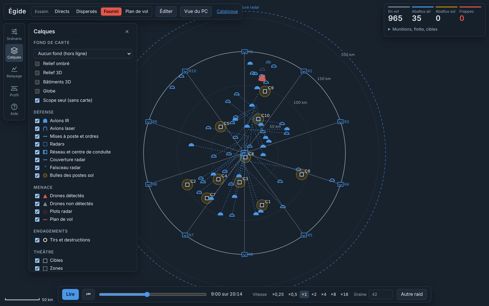
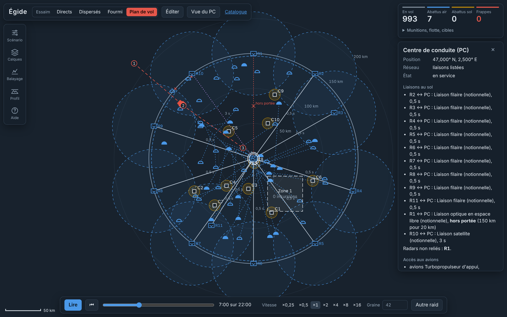
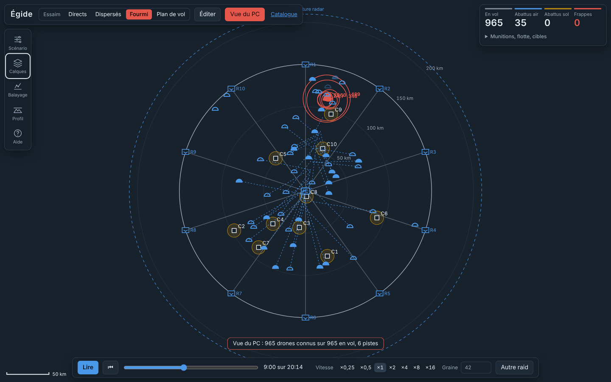
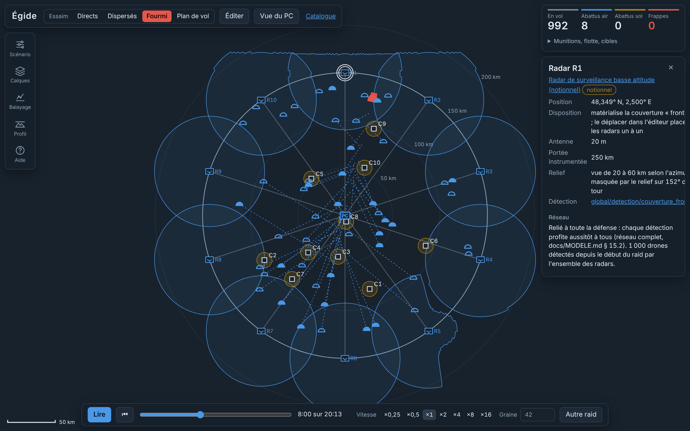

# Égide

Simulation de défense du territoire face à un essaim de drones rapides, jouable comme un jeu de stratégie vu de
dessus et assez rigoureuse pour en prouver les résultats. Le défenseur dispose de radars, d'un centre de conduite
relié par un réseau de liaisons, de postes sol-air sur les cibles et d'avions en orbite armés de roquettes guidées ;
l'attaquant choisit sa tactique, ou suit le plan de vol que vous dessinez, sur la vraie Terre et son relief.


> Scénario notionnel : ordres de grandeur publics, aucune performance réelle de système identifié. Le dépôt public
> ne contient que des modèles notionnels ; les modèles de systèmes réels se rangent dans un catalogue privé
> (`prive/`, ignoré par git) que l'outil charge de la même façon.

## Ce que fait Égide

- **Répond à deux questions** : à quelle vitesse les avions doivent-ils se mettre à poste, selon leur nombre, pour
  intercepter un essaim dont on ignore la route ? Combien de postes sol-air faudrait-il sans eux ?
- **Simule sur la vraie Terre** : ellipsoïde WGS84, distances géodésiques, relief qui masque radars et liaisons radio.
- **Modélise l'information** : la conduite ne sait que ce que ses radars lui transmettent, par des liaisons qui ont
  une latence, une portée et qui peuvent tomber en panne ; elle n'affecte que les avions qu'elle peut joindre.
- **Se joue à la souris** : placer cibles, radars et avions, relier les unités, dessiner le plan de vol de l'essaim et
  des zones protégées, donner des ordres et couper des liaisons en plein raid.
- **S'explique** : chaque unité et chaque algorithme a sa fiche (équations, hypothèses, sources, code) ; un clic sur une
  entité dit pourquoi elle fait ce qu'elle fait.
- **Se prouve** : graines fixées, intervalles de confiance, empreinte de reproductibilité, convergence en pas de temps,
  duels à nombres aléatoires communs, criblage de sensibilité, et près de 200 tests qui s'appliquent d'eux-mêmes à tout
  nouveau modèle.

## Lancer

macOS : double-clic sur `lancer.command`. Windows : `lancer.bat`. La page s'ouvre sur http://127.0.0.1:8766.
Rien à installer : JavaScript sans compilation, bibliothèques embarquées dans `vendor/`.

## En bref

Scénario de référence (1 000 drones à 800 km/h, 10 cibles, 200 postes sol, 50 avions à 500 km/h), 30 raids par
tactique, moyenne et intervalle de confiance à 95 % :

| Tactique de l'essaim | Frappes sans avions | Frappes avec 50 avions | Détruits par les avions |
|---|---|---|---|
| Groupes directs | 650 ± 21 | 395 ± 27 | 257 |
| Dispersés | 524 ± 8 | **187 ± 11** | 407 |
| Fourmi (couloir compact puis éclatement) | 668 ± 19 | 401 ± 25 | 272 |

- Les avions divisent les frappes par 1,6 à 2,8. La tactique fourmi est la plus efficace pour l'attaquant : le couloir
  compact sature chaque avion sur un passage, et l'éclatement tardif oblige la flotte à se partager.
- Face aux groupes compacts, la limite est la cadence de tir par passage, pas le stock de munitions.
- Avec 50 avions, garantir 5 avions sur une route quelconque demande ~350 km/h ; 8 avions, ~465 km/h ; 10, ~525 km/h.

Le dossier de preuve du scénario de référence (`node src/preuve.js dossier`) redonne 403 ± 26 frappes en tactique
fourmi, et montre que le pas de temps de 0,5 s a convergé alors que celui de 1 s ne l'a pas.

## L'écran

La carte occupe tout l'écran ; le reste flotte par-dessus et se replie.

- **En haut** : la tactique de l'essaim, l'éditeur, la Vue du PC, le catalogue.
- **À gauche** : un rail de panneaux, un à la fois (touches 1 à 5) — Scénario, Calques, Balayage, Profil, Aide.
- **À droite** : le bilan en quatre chiffres, ses détails repliés, et l'inspecteur au clic sur une entité.
- **En bas** : la lecture (×0,25 à ×16, frise, graine) et, en édition, la barre d'outils.

Symbologie inspirée d'APP-6 : dôme bleu plein pour un avion IR, creux pour un avion laser, cadre bleu pour un radar
(R1, R2…) et pour le poste de commandement (PC), demi-losange rouge pour un drone détecté (gris s'il ne l'est pas),
carré pour une cible, cercle ocre pour une bulle sol qui pâlit à mesure qu'elle s'épuise.

Le panneau **Calques** choisit le fond de carte (sombre, OpenStreetMap, plan ou photographies IGN, relief ombré ou
3D, bâtiments 3D, globe ; chaque source est un fichier de `cartes/`) et affiche ou masque chaque famille d'entités.
Ce qui est masqué ne se survole, ne s'inspecte ni ne s'édite.



### Trois tactiques adverses

<table>
<tr>
<td width="50%"></td>
<td width="50%"></td>
</tr>
<tr>
<td><b>Fourmi</b>, vue zoomée : tout l'essaim entre par un même couloir, éclate, puis se répartit sur ses cibles pendant que les avions convergent.</td>
<td><b>Groupes directs</b> : chaque groupe arrive d'un cap tiré au hasard, en vague serrée, droit sur sa cible.</td>
</tr>
<tr>
<td colspan="2" align="center"></td>
</tr>
<tr>
<td colspan="2"><b>Dispersés</b> : chaque drone vient seul, de n'importe quel cap, départs étalés. La plus facile à défendre : les avions trouvent des cibles partout. La quatrième tactique, <b>plan de vol</b>, suit l'itinéraire que vous dessinez.</td>
</tr>
</table>

### Avec ou sans couche aérienne

Même raid fourmi, même graine, en fin de raid :

<table>
<tr>
<td width="50%"></td>
<td width="50%"></td>
</tr>
<tr><td>Avec 50 avions : <b>469 frappes</b>.</td><td>Sans avions : <b>713 frappes</b>.</td></tr>
</table>

## Éditer à la souris

« Éditer » met le raid en pause au début et ouvre la barre d'outils :

- **Sélection** (S) : glisser pour déplacer cibles, avions, radars, PC, points de passage ou zones ; rectangle ou
  Maj+clic pour sélectionner ; clic droit pour envoyer la sélection en gardant sa formation ; Ctrl+1 à 9 forme un
  groupe, 1 à 9 le rappelle ; Suppr efface ; Ctrl+Z annule.
- **Cible** (C) et **Radar** (R) : un clic, une unité. Toucher un radar fait passer la couverture « frontière » en
  radars placés un à un, chacun avec sa portée.
- **Liaison** (L) : un clic sur une unité, un clic sur l'autre, avec le moyen choisi dans la liste (filaire, radio,
  satellite, optique). « Réseau complet » y revient.
- **Plan de vol** (P) : l'essaim suit le tracé en colonne, puis chaque drone rejoint sa cible ; le panneau Profil
  trace son altitude au-dessus du relief réel.
- **Zone** (Z) : un clic par sommet, double-clic ou Entrée pour fermer ; une zone protégée compte les incursions.


**En plein raid**, en pause, « Éditer » passe en mode ordres : sélectionnez des avions puis clic droit pour les
envoyer depuis le PC ; sélectionnez un radar, le PC ou une liaison puis Suppr pour le mettre hors service. Tout est
enregistré dans le scénario avec son instant, et le raid se rejoue à l'identique.


Chaque geste devient une modification du scénario, comme un curseur : l'annulation, l'export JSON, les réglages
enregistrés et la reproductibilité par la graine valent pour tout ce que vous placez à la main.

## Réseau d'information

Par défaut, tout le monde parle avec tout le monde, sans délai. Dès la première liaison tracée, le réseau devient
explicite : chaque radar relié au PC (au fil par défaut), le PC relié à chaque groupe d'avions (par radio), et vos
liaisons en plus.

- La conduite n'apprend un drone qu'après la latence du chemin depuis le radar qui le voit ; un radar non relié voit
  pour rien.
- Ses consignes, comme vos ordres, n'arrivent à l'avion qu'après la latence de sa liaison ; un avion hors de portée
  radio n'est plus affecté (croix rouge).
- Les pannes se datent ; le PC peut devenir une cible de l'essaim (panneau Scénario), détruit à la première frappe.
- Le synoptique trace chaque liaison selon son moyen et sa latence ; une liaison coupée est barrée en rouge.



**Vue du PC** (V) : l'écran ne montre plus que ce que sait la conduite — les drones qu'elle connaît, regroupés en
pistes par son algorithme de pistage. La vérité terrain revient au même bouton.



## Relief

Un terrain du catalogue (`unites/terrains/`), choisi dans le panneau Scénario, donne au moteur le relief du théâtre :
chaque radar a son masque d'horizon, un drone qui vole bas derrière une crête n'est pas vu, et les liaisons radio et
optiques exigent la vue directe. L'écran trace la couverture réelle de chaque radar.



Le dépôt livre un relief synthétique de démonstration. Pour le vrai relief d'un théâtre, depuis un poste qui a le réseau :

```sh
node outils/terrain.js --nom centre_france --lat 47 --lon 2.5 --rayon_km 320 --pas_km 1
node outils/indexer.js
```

Le terrain est ensuite un fichier : le moteur travaille hors ligne.

## Comprendre : fiches et inspecteur

Un clic sur une entité ouvre l'**inspecteur**, mis à jour en direct : pour un avion, pourquoi la conduite l'a envoyé
là (piste retenue, score, délai, alternatives écartées) et par quelle liaison elle le joint ; pour un drone, chaque
tir subi, sa probabilité de survie Π(1 − Pk) et la cause de sa perte ; pour une cible, sa défense ; pour un radar, sa
portée, son masquage par le relief et sa latence jusqu'au PC ; pour le PC, l'état de tout le réseau.


Le lien **Catalogue** ouvre l'explorateur : une fiche par unité (fidélité, lignée, sources, paramètres avec l'ancêtre
qui les fixe, algorithmes) et par algorithme (équations, hypothèses, domaine de validité, références, code, utilisateurs).

<table>
<tr>
<td width="50%"></td>
<td width="50%"></td>
</tr>
</table>

## Balayage

Le panneau **Balayage** fait varier un réglage, rejoue le raid sur plusieurs graines par valeur et trace chaque
grandeur avec son intervalle de confiance, calculé en arrière-plan.


## Étendre : unités, algorithmes, cartes

```
unites/<famille>/<classe>/<unite>.json    une unité par fichier, héritage par herite_de, chaque clé documentée
unites/liaisons/<moyen>.json              moyens de communication : latence, portée, vue directe
unites/terrains/<terrain>.json            reliefs : grilles d'altitudes (node outils/terrain.js)
algos/global/<rôle>/<algo>.js             un algorithme par module : fiche « meta » + fonctions du rôle, sans import
cartes/fonds|relief|batiments/<source>.json   une source de carte par fichier, attribution obligatoire
prive/unites/…  prive/algos/…             votre catalogue privé (ignoré par git), identifiants préfixés « prive/ »
scenarios/                                scénarios JSON, chaque clé documentée
```

Après tout ajout : `node outils/indexer.js`. La suite de conformité vérifie d'elle-même tout fichier déposé, public ou
privé : fiche complète, rôle tenu, aucune dépendance cachée, paramètres présents, invariants du rôle. Les rôles et
leurs fonctions sont décrits dans [docs/MODELE.md § 10](docs/MODELE.md).

## En ligne de commande

```sh
node src/campagne.js                                            # scénario de référence, 50 raids
node src/campagne.js --tirages 200 --rouge.tactique direct      # toute valeur se règle par son chemin
node src/campagne.js --rouge.surcharges.vitesse_kmh 600         # y compris une valeur d'unité
node src/campagne.js --balayer bleu.avions.1.nombre=0,10,30,60  # une campagne par valeur
uv run --with matplotlib python -m analyse.abaques              # abaques analytiques et récapitulatif
```

<table>
<tr>
<td width="50%"></td>
<td width="50%"></td>
</tr>
<tr>
<td>Vitesse minimale de mise à poste pour garantir k avions sur une route quelconque.</td>
<td>Postes sol nécessaires selon la concentration adverse, sans avions puis avec 20, 50 et 100 avions.</td>
</tr>
</table>

## Prouver

Chaque résultat des outils de preuve porte son **empreinte** (SHA-256 du scénario, des unités, des algorithmes en
jeu et du code du moteur) et ses écarts au scénario de référence : deux résultats de même empreinte et de mêmes
graines sont identiques au bit près.

```sh
node src/preuve.js dossier                                   # dossier Markdown : résultats, convergence, modèles, limites
node src/preuve.js convergence --pas 2,1,0.5,0.25 --tirages 10
node src/preuve.js duel --variante rouge.tactique=direct     # A contre B, mêmes graines, écart et verdict
node src/preuve.js morris --facteur bleu.avions.1.nombre=0:60 --facteur bleu.sol.nombre=0:200
node src/preuve.js empreinte
```

- **Convergence** : la campagne rejouée à plusieurs pas de temps, chaque pas comparé au plus fin tirage par tirage.
- **Duel A/B** : deux variantes sur les mêmes graines ; différence appariée, intervalle de confiance, gain des
  nombres aléatoires communs mesuré.
- **Morris** : classement des réglages par influence (μ*, μ, σ) et seuil de bruit ; il a révélé, par exemple, que
  l'étalement des départs n'a aucun effet hors tactique dispersée.

## Rigueur

- Unités SI et géodésie WGS84 dans tout le calcul ; Vincenty vérifié sur les exemples de GeographicLib au millimètre.
- Hasard à graine : une graine rejoue un raid à l'identique, ordres et pannes compris.
- Chaque formule codée cite son paragraphe de [docs/MODELE.md](docs/MODELE.md), et un test vérifie que chaque renvoi existe.
- Formules fermées en Python et en JavaScript, vérifiées l'une contre l'autre ; simulation confrontée aux formules.
- Chaque refonte prouvée : le moteur géodésique retrouve les statistiques de la v0.1, le passage aux algorithmes en
  fichiers redonne les bilans exacts, et le réseau complet sans relief laisse ces bilans inchangés.
- Limites connues : drones sans contre-mesures ni évitement, radar parfait dans sa portée, pas encore de débit ni de
  brouillage sur les liaisons (MODELE § 7, § 15 et § 16).

## Documentation

- [docs/MODELE.md](docs/MODELE.md) : toutes les équations et hypothèses.
- [docs/PLAN_V2.md](docs/PLAN_V2.md) : feuille de route, jalons, idées et suggestions retenues.

## Tests

```sh
npm test                 # rapide
npm run test:complet     # ajoute l'équivalence avec la v0.1 (~2 min)
pytest -q tests
ruff check analyse tests
```
